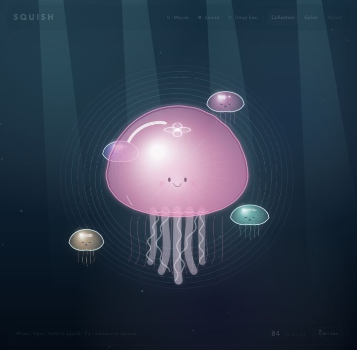
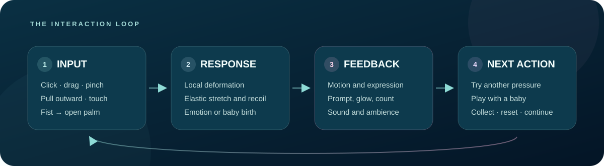
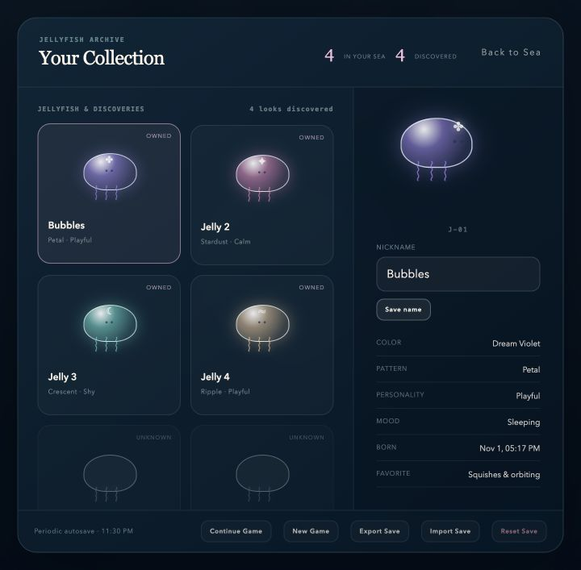

# SQUISH

### A Soft Jellyfish Interaction Experience

**Assignment 3 — An Interactive Experience**

Individual project · Creative Computing · 2026



## Overview

SQUISH is a small browser-based interactive artwork about touching something that cannot physically be touched. The player meets a translucent mother jellyfish in a quiet deep-sea environment and can press, stretch, and gently pull its soft bell. The body deforms locally, lags behind the pointer, changes expression, and springs back with sound.

Pulling outward from the bell can nurture a baby jellyfish. Each baby receives its own color, pattern, personality, emotions, short-term memories, and autonomous behavior. The experience is designed for anyone who wants a short, calm, playful interaction rather than a score-driven game.

## Intended experience

- **For:** a single player using a desktop browser.
- **Action:** touch, squish, stretch, or pinch a digital jellyfish.
- **Response:** the body deforms, rebounds, changes emotion, or produces a baby.
- **Feedback:** animation, facial expression, written prompts, interaction sounds, and generative deep-sea music explain what happened.
- **Next action:** try another pressure, play with a baby, release a bubble, open the collection, or clear the current sea.



## Main interaction

The mother jellyfish is drawn from a soft spring-based contour rather than being scaled as one rigid image. This makes the contact point visibly dent and stretch in the direction of the player's movement.

| Input | Program response | Feedback to the player |
|---|---|---|
| Move the pointer or index finger closer | Nearby babies follow, orbit, or flee according to personality and trust | Smooth movement and changing expressions |
| Click or pinch the bell | The touched area compresses while the rest of the body follows with delay | Local dent, face reaction, soft jelly sound |
| Hold an edge and pull outward | The bell stretches toward the pointer | Increasing stretch, changing prompt, elastic tension |
| Release after crossing the threshold | A baby separates, turns upright, grows tentacles, and begins to swim | “Pop” motion, sound, glow, updated count and collection |
| Touch a baby jellyfish | Its emotion and memory values change | Squash, rebound, blush, surprise, sleep/wake, or playful movement |
| Click open water / make a fist then open it | One bubble is released | The bubble rises and can meet a baby jellyfish |

Mouse, touch, and camera tracking share the same world-coordinate input model. Direct player interaction takes priority over autonomous follow, flee, or social behavior.

## Features

- Local soft-body deformation with elastic rebound
- Mouse, touch, and optional camera-hand input
- Baby jellyfish born from any edge of the mother's bell
- Four top patterns that match the collection archive
- Calm, Shy, and Playful personalities
- Emotion, trust, energy, stress, and short-term memory
- Follow, flee, orbit, sleep, and autonomous social interactions
- Procedurally generated deep-sea ambience and interaction sounds
- Bubble interaction
- English quick guide and responsive interface
- Versioned autosave, backup recovery, JSON import/export, and collection archive
- Camera-free fallback when permission or tracking is unavailable

## Run locally

No package installation or build step is required.

```bash
git clone https://github.com/Only-SerenaLIN/SQUISH-interactive-experience.git
cd SQUISH-interactive-experience/web
python3 -m http.server 4173
```

Open <http://127.0.0.1:4173/> in a desktop browser.

Opening `web/index.html` directly may display the artwork, but a local server is recommended for consistent camera permission, script loading, and save behavior.

### Browser requirements

- A current version of Chrome, Edge, or Safari
- JavaScript and Web Audio enabled
- Camera permission only for Camera Gestures or Live View
- An internet connection for the optional Handsfree.js library loaded from unpkg

Mouse and touch interaction continue to work when the camera is denied, unavailable, or the tracking library cannot load.

## Controls

| Control | Action |
|---|---|
| Move pointer | Approach and influence nearby jellyfish |
| Click / press | Touch or locally squish a jellyfish |
| Hold and drag | Stretch the bell |
| Pull outward from an edge, then release | Nurture a baby jellyfish |
| Click open water | Release a bubble |
| `C` | Toggle camera gestures |
| `B` | Toggle deep-sea / live-camera background |
| `M` | Toggle ambient music and interaction sounds |
| `D` | Toggle the emotion debug panel |
| `R` | Clear the current sea while keeping discoveries |
| `?` | Open the interaction guide |

Camera mode uses one index finger for light interaction, a thumb–index pinch for squishing and nurturing, and a fist-to-open-palm gesture for releasing one bubble.

## Collection and save system



Each baby has a unique ID, nickname, color, top pattern, personality, emotion values, memory, and birth time. The collection distinguishes between jellyfish currently in the sea and appearances discovered in the past.

The browser automatically saves births, nickname changes, discoveries, settings, tutorial progress, and important memories. The Collection panel also provides **New Game**, **Export Save**, **Import Save**, and **Reset Save**. Destructive actions require confirmation. A damaged save opens recovery choices instead of crashing the experience.

## Handling mistakes and interruptions

- **Camera permission denied:** mouse and touch remain active.
- **Hand tracking lost:** the current gesture pauses instead of completing accidentally.
- **Tracking library unavailable:** a clear message appears and the main interaction remains playable.
- **Repeated or incomplete pull:** the bell rebounds without creating duplicate babies.
- **Maximum population reached:** no extra baby is created and the player receives feedback.
- **Damaged save or invalid import:** retry, restore a backup, or create a new save.
- **Audio unavailable or muted:** all visual feedback remains functional.
- **Page hidden:** ambience fades out and the game saves in the background.

## Testing

Run the browser-independent JavaScript tests from the repository root:

```bash
node --test tests/*.test.js
```

The current suite contains **35 tests** covering emotion and memory, unified pointer behavior, follow/flee steering, social pairing and interruption, save validation, backup recovery, import/export, and discovery history.

Before submission, also check the main interaction in a fresh browser session:

1. Start the local server.
2. Squish and release the mother jellyfish.
3. Pull outward from the bell and create one baby.
4. Touch the baby and observe its reaction.
5. Deny camera access and confirm mouse input still works.
6. Refresh and confirm the baby and collection entry return.

## Project structure

```text
SQUISH-interactive-experience/
├── web/
│   ├── index.html             # Interface and accessible page structure
│   ├── styles.css             # Responsive deep-sea UI
│   ├── app.js                 # Canvas world, input, audio, animation and integration
│   ├── emotion-system.js      # Personality, emotion, stats and memory
│   ├── behavior-system.js     # Unified pointer, follow, flee and steering
│   ├── social-system.js       # Autonomous social interactions
│   └── save-system.js         # Versioned save and collection data
├── tests/                     # Browser-independent JavaScript tests
├── docs/                      # README screenshots and diagrams
├── PROCESS.md                 # Design process, user trial and AI-use record
└── CREDITS.md                 # Libraries, references and media credits
```

## Known limitations

- Camera quality depends on lighting, hand visibility, device speed, and browser support.
- Handsfree.js and its hand model use a CDN; camera mode may not start offline.
- Saves use browser `localStorage`, so they do not automatically follow the player to another browser or device. Export/import is provided.
- The interface is optimized for desktop presentation. Touch works, but small screens provide less space for the collection and camera preview.
- The quiet generated ambience may be difficult to hear on small laptop speakers.
- SQUISH is an interactive artwork, not a medical or therapeutic product.

## Process, trial, and credits

Development decisions, AI assistance, and iteration notes belong in [`PROCESS.md`](PROCESS.md). Libraries and references belong in [`CREDITS.md`](CREDITS.md).

The recorded user trial, original evidence photograph, resulting background-control improvement, and the decision to defer multiplayer are documented in [`PROCESS.md`](PROCESS.md).

The Git history contains separate commits for the soft-body prototype, gesture input, emotions and memory, follow/flee behavior, social interaction, collection and saves, visual redesign, pattern rendering, and generative audio.

## Visual evidence to add before submission

The repository already includes the main experience screenshot, collection screenshot, interaction-loop diagram, and original user-trial photograph. One optional addition would make the submission easier to assess:

1. **An 8–12 second screen recording** showing one squish, rebound, baby birth, and the ambient sound. Save it as `docs/squish-demo.mp4` and link it here or in the repository description.

## Repository

Public repository: <https://github.com/Only-SerenaLIN/SQUISH-interactive-experience>

Live demo: not currently deployed; use the local run instructions above.
